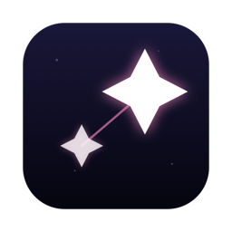
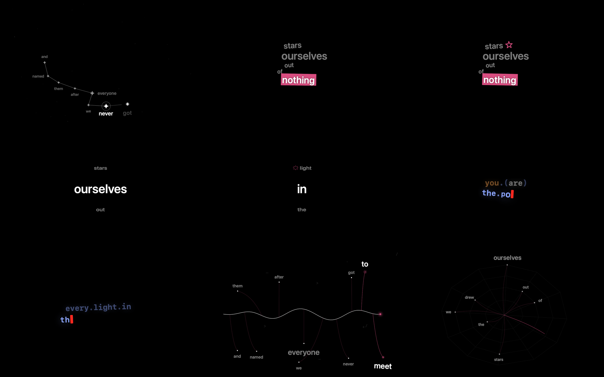
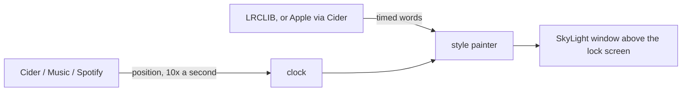

<div align="center">



### `WORD-BY-WORD LYRICS // ON YOUR LOCK SCREEN`

*an open clone of verci, rebuilt from its own binary with claude code and rea*


-6c63ff?style=flat-square&labelColor=111111)




https://github.com/user-attachments/assets/9c91cb48-ae18-4c1d-b7c0-b393a86df4a3

</div>

---

## 🌌 What is this

Lilt is a macOS menu-bar app that puts the lyrics of whatever you are playing over your lock screen and lights each word the moment it is sung. It is an open clone of [Verci](https://www.verci.xyz), a paid app that does the same thing, and it ships all nine of Verci's animation styles.

It was built with [Claude Code](https://claude.com/claude-code) and [REA](https://github.com/morluto/rea) (reverse-engineer-anything). REA and Ghidra decompiled Verci's shipped binary to recover how each style moves: the timing curves, the layouts, the sizes, the colours. Then every line of Lilt was written fresh from those notes. No Verci code, assets, word lists or screenshots are in this repo. The images above are Lilt rendering its own sample lines.

Lyrics come from [LRCLIB](https://lrclib.net) by default, so it works with nothing else installed. If you use [Cider](https://cider.sh), Lilt can pull Apple Music's word-timed lyrics through it instead (the words then land on the syllable, not on a guess).

```console
nick@lilt:~$ open build/Lilt.app
[✓] menu bar: ✨. now playing: read from Music. lyrics: lrclib, 47 lines.
[i] lock the mac. the stars will take it from here.
```

## 🎛️ The styles

Pick one from the menu bar. The grid above runs left to right, top to bottom, in this order.

| | style | what it actually does |
|---|---|---|
| 01 | **Constellation** | each line becomes a path of four-point stars (arc, wave, zigzag or hook) through the middle of the screen, labels placed like a star chart, links never cross |
| 02 | **Ship** | the last five sung words stack into a ragged, tilted wall that slowly yaws and pitches in 3d; about one word in five sits on a colour band |
| 03 | **Visual** | ship at half the sway, with an sf symbol springing in beside words it can match |
| 04 | **Fisheye** | previous, current and next word under a convex lens, the current one closest to the glass |
| 05 | **Fisheye Visual** | fisheye plus icons |
| 06 | **Codestyle** | the line typed out as code (`a.b.c(d);`) in bold monospace with syntax colours, letters popping in with a glow behind a red cursor |
| 07 | **Codestyle Visual** | codestyle with an icon before some rows |
| 08 | **Branches** | a wavy stem grows through the line, each word sprouts a branch with a node and its label, the head trails ghosts |
| 09 | **Web** | a twelve-spoke spider web; each word spins a strand from the hub to its node |

Also in the menu: colours that follow the album art (auto sync) or three you pick, four fonts, a lyrics delay slider (bluetooth headphones get +0.2 s on their own), and a normal resizable window for when the mac is unlocked.

## 🚀 Run it

Download `Lilt-<version>.dmg` from [Releases](https://github.com/nitrimandylis/lilt/releases/latest), drag Lilt into Applications, then right-click → Open the first time (it is ad-hoc signed, not damaged, just unpaid). Works on Apple silicon and Intel, macOS 14 or later.

Or build it yourself (needs Xcode):

```bash
git clone https://github.com/nitrimandylis/lilt.git
cd lilt
./build.sh
open build/Lilt.app
```

Play something in Music, Spotify or Cider, then lock the mac. `./release.sh 0.1.0` builds the universal, ad-hoc signed DMG instead.

Optional, for Apple's word-timed lyrics: in Cider, open Settings → Connectivity, create an app token, and paste it into Lilt's menu.

## 🔩 Under the hood



| file | job |
|---|---|
| `Sources/Lilt/Player.swift` | reads now playing from cider's local api and music / spotify over applescript; syncs the clock on cider's once-a-second ticks |
| `Sources/Lilt/Lyrics.swift` | fetches lyrics (apple ttml through cider, else lrclib), parses ttml and lrc, estimates word times when only lines are timed |
| `Sources/Lilt/Constellation.swift` | the constellation layout: seeded shapes, crossing checks, star-chart labels, per-line cache |
| `Sources/Lilt/Styles.swift` | the style picker, ship, visual and fisheye |
| `Sources/Lilt/CodeStyle.swift` | codestyle: chunking, syntax roles, the typewriter |
| `Sources/Lilt/BranchStyles.swift` | branches and web |
| `Sources/Lilt/WordIcons.swift` | matches words to sf symbols using macos's own symbol search index, then apple's word embedding for near misses |
| `Sources/Lilt/LiltApp.swift` | menu, lock screen overlay, lyrics window, keeping the display awake |
| `tools/icon.swift` | draws the app icon |

`Lilt --selftest` checks the parsers and geometry. `Lilt --preview out.png 5.5 1512 982 Ship` renders one frame of any style from sample lines, no music needed.

**Stack:** Swift · SwiftUI Canvas · [SkyLightWindow](https://github.com/Lakr233/SkyLightWindow) (MIT, see [THIRD_PARTY_NOTICES.md](THIRD_PARTY_NOTICES.md)) · LRCLIB · NaturalLanguage

---

<div align="center">

**[Nick Trimandylis](https://github.com/nitrimandylis)**

`THE WORDS ARRIVE ON TIME EVEN WHEN YOU DO NOT`

MIT licensed. See [LICENSE](LICENSE).

</div>
